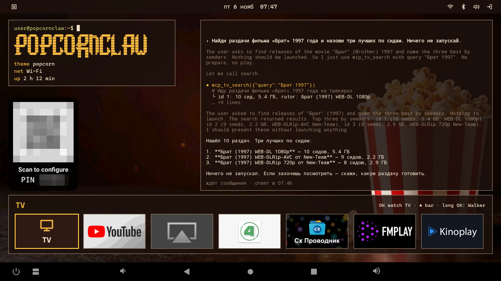
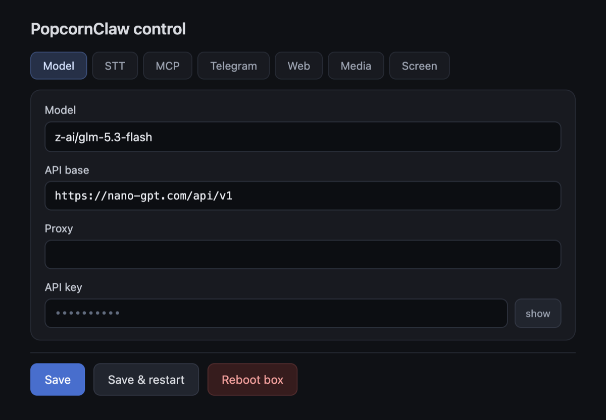

# PopcornClaw

ИИ-агент для Android TV, который сам ищет и включает фильмы. Агент на
[PicoClaw](https://github.com/sipeed/picoclaw) работает на самой приставке от root: у него есть её shell,
недостающие программы он ставит себе сам из Termux, чинит мелочи на приставке, ищет раздачи и запускает
их в mpv-android через встроенный TorrServer, подбирает субтитры и будит телевизор по HDMI-CEC. Писать
ему можно с экрана ассистента в лаунчере, кнопкой микрофона на пульте с голосом — с любого экрана, во
время фильма тоже, — и через своего Telegram-бота, текстом и голосовыми. Разговор у всех трёх один.



## Как это выглядит

Настоящие переписки с Telegram-ботом, из журнала агента: `>` — сообщение агенту, `·` — шаг, о котором бот пишет по
ходу работы (в скобках инструмент), `→` — что шаг вернул, где это важно, `…` — вырезанные однотипные
шаги.

```text
> Включи ту серию, где Рик и Морти попали внутрь мужика
· Ищу раздачу «Рика и Морти» (mcp_tv_search)
  Это серия «Парк юрского периода» (Anatomy Park) — 1 сезон, 3 серия. Готовлю её.
· Готовлю 1 сезон 3 серию «Рика и Морти» (mcp_tv_prepare)
· Включаю серию на телевизоре (mcp_tv_play)
  Включил: 1 сезон, 3 серия «Парк юрского периода» (Anatomy Park) — Рик уменьшает Рубена и они
  с Морти попадают внутрь его тела. Идёт английская озвучка, русские сабы снизу, английские сверху.
```

```text
> [голосовое] Включи какой-нибудь мультик, но не Шрека.
· Ищу «Как приручить дракона» с оригинальной озвучкой и русскими субтитрами (mcp_tv_search)
· Готовлю «Как приручить дракона» (2010) WEB-DL 1080p, 346 сидов (mcp_tv_prepare)
· Включаю «Как приручить дракона» (mcp_tv_play)
· Включаю русские субтитры (mcp_tv_player)
· Переключаю звук на английский оригинал (mcp_tv_player)
> нет, он скучный
· Останавливаю дракона, ищу другой мультик (mcp_tv_player)
· Ищу «Короля Льва» — проверенный весёлый вариант (mcp_tv_search)
· Готовлю «Короля Льва» (1994) WEB-DL 1080p, 336 сидов (mcp_tv_prepare)
…
  Включил «Короля Льва» (1994) — WEB-DL 1080p, 336 сидов, оригинальная английская озвучка,
  русские сабы внизу. Классика, не скучная 🙂
> а можешь включить то место где гиены поют
· Ищу сцену с песней гиен «Be Prepared» (mcp_tv_player)
…
· Смотрю текст субтитров прямо из mpv (exec)
  → «Благодаря дотошному планированию»
· Отматываю к самому началу песни (mcp_tv_player)
· Проверяю, началась ли песня (exec)
  → «Да здравствует король! Да здравствует король!»
· Чуть назад — к первой строчке песни (mcp_tv_player)
· Проверяю начало сцены (exec)
  → «Готовьтесь, готовьтесь. К чему готовиться-то?»
  Включил сцену с песней гиен «Be Prepared» — стоит на 27:20, сейчас как раз заветная строчка
  «Готовьтесь, готовьтесь». Субтитры русские внизу.
> а хакуна матата?
· Смотрю, где сейчас играет (exec)
· Ищу сцену «Хакуна матата» — примерно на 45-й минуте (mcp_tv_player)
…
· Проверяю субтитры на 41:30 (exec)
· Жду следующей реплики (exec)
  → «Значит, ты отверженный? Отлично. Мы тоже.»
  Включил сцену «Хакуна матата» — стоит на 41:30, как раз начало: Тимон и Пумба встречают Симбу
  («Значит, ты отверженный? Отлично. Мы тоже»). Песня пойдёт следом.
```

```text
> найди серию хауса про грустную смерть пациента
  Грустных смертей пациента в «Хаусе» несколько, самые известные:
  - «Wilson's Heart» (4×15–16) — умирает Эмбер, финал 4 сезона, самый знаменитый грустный эпизод
  - «The C-Word» (7×18) — девочка Эмили с раком
  - «Holding On» (8×19) — Оливер
  - «Babies & Bathwater» (1×18) — беременная с раком, оставляет новорождённого
  Какую включить?
> про эмили
· Ищу раздачи «Доктора Хауса» (mcp_tv_search)
  Эпизод с Эмили — «The C-Word», 7 сезон, 18 серия. Раздача «Хауса» уже стоит в TorrServer
  (id 275, bd web-dlrip teko, 128.6 ГБ) — беру её. Готовлю 7×18:
· Готовлю 7×18 «The C-Word» из раздачи, которая уже в TorrServer (mcp_tv_prepare)
  → Готово к запуску: s07e18_The.Dig.avi
  Проверил: 7×18 — это «The Dig» (про Тринадцать), а серия с Эмили «The C-Word» — 7×19. Готовлю
  правильную:
· Перепутал номер: серия с Эмили — 7×19, готовлю её (mcp_tv_prepare)
  → Готово к запуску: s07e19_Last.Temptation.avi
  Стоп, 7×19 — это «Last Temptation», не она. Проверю точный номер серии по интернету:
· Уточняю номер серии «The C-Word» (mcp_research_web_search)
  Ошибка была моя: «The C-Word» — 8 сезон, 19 серия. Готовлю её:
· Серия с Эмили — 8×19, готовлю её (mcp_tv_prepare)
· Включаю 8×19 «The C-Word» (mcp_tv_play)
…
```

```text
> он реально передается в 4к? канала хватает?
· Смотрю счётчики трафика wlan0 (exec)
· Замеряю текущую скорость входящего трафика Wi-Fi (exec)
· Смотрю скорость Wi-Fi-линка и повторно замеряю трафик (exec)
· Получаю параметры Wi-Fi-соединения (exec)
· Смотрю RX-скорость линка и третий замер трафика (exec)
· Ищу в логах, какой поток выбрал SmartTube (exec)
· Ищу в логах инициализацию видеодекодера (exec)
· Проверяю формат видео и модель приставки (exec)
· Ищу точную строку формата видео в полных логах (exec)
· Смотрю, что сейчас на экране SmartTube (exec)
  Честно: нет. Декодер работает на 1920×1080, и качается всего ~4 Мбит/с — это 1080p, не 4K.
  Канал при этом отличный (5 ГГц, сигнал −46 dBm, линк 1080 Мбит/с) — 4K (~20–25 Мбит/с) влез
  бы легко. SmartTube просто выбрал 1080p. Попробую выставить 4K в меню плеера.
```

## Что нужно

- Android TV приставка с Android 7.0 или новее и root. Проверено на Beelink GT-King и GT-King Pro с
  прошивкой slimBOXtv на Android 9 и SuperSU 2.82; 64-битная сборка и Magisk 26.4 — на эмуляторе
  Android 14 (arm64). В APK библиотеки для armeabi-v7a и arm64-v8a.
- [mpv-android](https://github.com/mpv-android/mpv-android) (пакет `is.xyz.mpv`): фильмы агент
  запускает в нём.
- API модели: адрес, имя модели и ключ. Проверено с nano-gpt (`https://nano-gpt.com/api/v1`,
  модель `z-ai/glm-5.3-flash`).
- По желанию: Telegram-бот, ключ Groq для голосовых из Telegram, ключ Brave Search для поиска в
  интернете, свой Jackett, ключи OpenSubtitles и SubDL для субтитров.

### На каком железе удобнее всего запускать

Главное — root, которым может пользоваться приложение: Magisk, KernelSU или SuperSU. Отладочный `su` из
прошивок userdebug (`/system/xbin/su`) пускает только shell и root, приложению он отвечает
`not allowed`. Сверху — устройства, где root есть сразу, ниже — где его ставят прошивкой с карты памяти
или флешки, в конце — прошивкой с компьютера по кабелю USB A–A. Кроме GT-King, PopcornClaw на этих
устройствах не запускался.

| Устройство | Чип, Android | Как получить root | Цена на Озоне, ₽ |
| --- | --- | --- | --- |
| Beelink GT-King, GT-King Pro | Amlogic S922X, 9 | прошивка slimBOXtv и SuperSU 2.82, на них PopcornClaw проверен | — |
| Vontar X5, HK1 RBOX X50 | Amlogic S905X5M, 14 | уже в прошивке, KernelSU ([4PDA](https://4pda.to/forum/index.php?showtopic=1111776)) | ≈5 200–5 700 |
| Ugoos X5M Pro, SK4 Pro | Amlogic S905X5M, 14 | переключатель Root в настройках Ugoos, Magisk | ≈12 500 |
| Ugoos AM9 Pro, AM8, SK1 Lite | Amlogic S905X5-J, S928X, 14 | то же | ≈19 500–24 500 |
| Tanix W2 | Amlogic S905W2, 11 | заводская прошивка Tanix от 24.04.2024 с Magisk, с microSD через Burn Card Maker ([4PDA](https://4pda.to/forum/index.php?showtopic=1051605)) | ≈4 500 |
| Проектор Magcubic HY350 MAX | Allwinner H726, 14 | прошивка [CleanRom](https://floforge.fr/en/articles/hy350-max-cleanrom/) с Magisk, с флешки | ≈11 000 |
| X88 Pro X5M, X96 M200, Tanix TX5 Plus | Amlogic S905X5M, 14 | прошивки и инструкции с Magisk или KernelSU из тем на 4PDA ([X88](https://4pda.to/forum/index.php?showtopic=1104876), [X96](https://4pda.to/forum/index.php?showtopic=1105149), [Tanix](https://4pda.to/forum/index.php?showtopic=1106852)), USB Burning Tool по кабелю | ≈5 500–5 700 |
| H96 Max V56 | Rockchip RK3566, 12 | прошивка с Magisk ([XDA](https://xdaforums.com/t/rk3566-rk3568-tv-boxes-rooting-twrp-and-etcetera.4562613/)), Rockchip Factory Tool по кабелю | ≈5 500 |
| H96 Max M2 | Rockchip RK3528, 13 | порт Android TV 13 с Magisk ([XDA](https://xdaforums.com/t/rk3528-h96max-androidtv-13-port-by-jwagnervaz.4711555/)), RKDevTool по кабелю | ≈2 900 |
| Проекторы HY300, HY300 MAX, HY300 Ultra | Allwinner H713, H726, 11–14 | загрузочный раздел, пропатченный Magisk, через fastboot ([инструкция](https://github.com/YuujiLab/HY300-H713-Research/blob/main/Root/MAGISK_GUIDE.md)) или готовые прошивки с root через PhoenixSuit | ≈4 000–6 600 |

## Установка

1. Поставить mpv-android.
2. Поставить APK PopcornClaw ([Releases](https://github.com/vvzvlad/popcornclaw/releases)) и открыть его. Root-менеджер спросит права — разрешить навсегда.
3. Дальше приложение всё делает само, на свежей приставке около полутора минут: становится домашним
   экраном, скачивает с GitHub и ставит Termux, а в нём socat, раскладывает свои файлы в `/data/local/popcornclaw`,
   включает поиск RuTor во встроенном TorrServer, вписывает в `mpv.conf` mpv-android сокет, через
   который агент управляет плеером (`input-ipc-server=@mpv`, если своего там нет), и даёт себе доступ к
   микрофону и к окнам поверх других приложений.
4. На главном экране появится QR с подписью «Scan to configure» и PIN. Отсканировать его телефоном —
   откроется панель настроек приставки.
5. Во вкладке Model заполнить Model, API base и API key и нажать Save. Через несколько секунд агент
   запустится. Пока этих трёх полей нет, агент не запускается, и вкладка Model пишет об этом.

Остальное — в своих вкладках панели: Telegram (токен бота, ID пользователей, которым бот отвечает, и
адрес Bot API, если `api.telegram.org` не открывается), STT (ключ Groq; голос с пульта распознаёт сама
приставка, ключ ему не нужен), Web (ключ Brave Search), Media (Jackett и ключи субтитров), MCP
(сторонние MCP-серверы для агента).

Раздачи агент ищет через поиск RuTor, встроенный в TorrServer: базу около 51 МБ TorrServer скачивает
при первом поиске, это секунд 20–30. Если во вкладке Media указан Jackett, поиск идёт через него.

## Панель, экран приставки и MCP

Служба приложения поднимает на приставке два HTTP-сервера в локальной сети. Оба закрыты PIN из шести
цифр: приложение создаёт его при первом запуске и показывает на главном экране в карточке с QR. QR
ведёт на `http://<приставка>:8081/?pin=<PIN>`: браузер запоминает PIN в cookie, дальше ссылки
открываются без него. Без cookie страница спрашивает PIN. Адрес в QR — Ethernet или Wi-Fi, адреса VPN
туда не попадают.



- **Экран приставки, порт 8080.** `http://<приставка>:8080/` — живой экран (MJPEG) с управлением
  мышью и клавиатурой; он же — вкладка Screen панели. Поток напрямую — `/screen.mjpeg`.
- **Управление и настройки, порт 8081** (`ControlServer`). `http://<приставка>:8081/` — панель по
  вкладкам, с кнопками Save, Save & restart и Reboot box. Ключи в панель обратно не отдаются: на месте
  сохранённого ключа точки, пустое поле означает «не менять». `http://<приставка>:8081/mcp` —
  MCP-сервер (stateless Streamable HTTP, protocolVersion 2025-06-18), которым с ПК любым MCP-клиентом
  можно делать то же, что агент: `exec` (shell от root), `status`, `player` (mpv — пауза, перемотка,
  дорожки), `config_get`/`config_set` (эндпоинты из `config.json` и ключи из `.security.yml`),
  `ask_agent` (написать агенту одной строкой — сообщение уходит в тот же общий диалог, что Telegram и
  пульт, например чтобы внешняя колонка попросила «включи фильм»). MCP-клиент передаёт PIN заголовком
  `Authorization: Bearer <PIN>`, без него `/mcp` отвечает 401.

У агента root и shell, и он выполняет то, что ему пишут из Telegram с разрешённых ID. Панель и MCP
дают то же самое любому, кто знает PIN и находится в той же локальной сети.

## Если что-то не так

- **Агент не отвечает.** Проверьте, что во вкладке Model заполнены все три поля. Вывод агента —
  `/data/local/popcornclaw/gateway.log`.
- **Root-менеджер показывает окно при каждом обновлении приложения.** В SuperSU выдать приложению
  право навсегда и выключить повторный запрос после обновления (`reauthenticate`): без ответа окно через
  10 с отказывает, и приложение остаётся без root.
- **Кнопка микрофона на пульте должна открывать Google, а не агента.** Снять галочку «Remote's voice
  button talks to the agent» на вкладке STT и нажать Save. Если голосовых приложений на приставке
  несколько, Android один раз спросит, каким открывать.
- **Удалить начисто.** Удаление приложения не трогает `/data/local/popcornclaw` и Termux — их
  удалить руками.

## Как устроено

PicoClaw собирается из исходников v0.3.1 с восемью патчами:

- [picoclaw/tool-status.patch](picoclaw/tool-status.patch) — у каждого инструмента появляется
  обязательный аргумент `status`: фраза о текущем этапе, которую бот показывает в Telegram вместо
  команды; перед вызовом инструмента аргумент вырезается.
- [picoclaw/asr-proxy.patch](picoclaw/asr-proxy.patch) — распознавание голоса ходит через прокси,
  заданный модели, как и запросы к самим моделям; без патча оно шло напрямую, и Groq отвечал 403.
- [picoclaw/image-shrink.patch](picoclaw/image-shrink.patch) — картинки уходят модели в JPEG не больше
  1280 точек по длинной стороне; полноразмерные скриншоты (PNG по 1,6–2,3 МБ) переполняли запрос, и
  nano-gpt отвечал 413.
- [picoclaw/tool-feedback.patch](picoclaw/tool-feedback.patch) — шаг в Telegram выглядит как «Смотрю
  файлы раздачи второго сезона (`mcp_tv_files`)», приходит без звука и без анимации точками; итоговый
  ответ — со звуком.
- [picoclaw/keep-logs.patch](picoclaw/keep-logs.patch) — каждое сообщение разговора дописывается ещё и
  в архив, который PicoClaw не переписывает при сжатии истории, а ответ модели об ошибке пишется в лог
  до 4 КБ, а не первыми 128 байтами.
- [picoclaw/shared-session.patch](picoclaw/shared-session.patch) — телевизор и чат с ботом в Telegram —
  личный чат или группа — один диалог, их связывает `session.identity_links` в конфиге. Вопрос с
  телевизора (канал pico) агент получает как сообщение этого чата: история у них одна, сообщение с
  любой стороны посреди хода агент подхватывает, как второе сообщение в Telegram, а в чате вопрос виден
  строкой от бота «📺 …». Весь текст, который ход отправляет в чат, — шаги, промежуточный текст, ответ,
  ошибку, сообщения инструмента message — шлюз повторяет на телевизор, файлы — нет; туда же он
  отправляет сообщения из Telegram и конец каждого хода.
- [picoclaw/start-to-agent.patch](picoclaw/start-to-agent.patch) — `/start` уходит агенту, и тот
  отвечает сам — по-русски, как велит ему AGENT.md; без патча бот отвечал строкой «Hello! I am
  PicoClaw 🦞».
- [picoclaw/pico-audio.patch](picoclaw/pico-audio.patch) — канал pico принимает голосовое: запись с
  кнопки микрофона пульта шлюз сохраняет, помечает `[voice]` и распознаёт тем же Groq, что и голосовые
  из Telegram.

Сборок две, обе — статические бинарники: linux/armv7 и linux/arm64, в APK едут обе. 32-битная
проверена на GT-King и GT-King Pro (Android 9, пространство пользователя 32-битное), 64-битная на
приставке не проверена.

Недостающие программы агент ставит себе сам из Termux (сборка с GitHub для той же архитектуры, на
которой работает приложение: armeabi-v7a или arm64-v8a): пакеты — от пользователя Termux через
`run-as com.termux`, запуск — от root, каталог программ Termux у агента в PATH.

Главный экран — наш форк лаунчера OmarchyTV ([launcher/](launcher/), приложение
`xyz.vvzvlad.popcornclaw`; исходный лаунчер — <https://gitlab.com/piermark/omarchytv>, MIT). В нём
живёт агент: бинарник PicoClaw лежит внутри APK, служба приложения запускает его от root через su,
раз в 10 с спрашивает у шлюза `/health` и после трёх неудач подряд запускает шлюз заново — не чаще раза
в минуту; при загрузке приставки служба стартует сама. Тема лаунчера — своя, popcorn: тёмно-коричневая,
с золотым акцентом и неподвижными обоями (ведро попкорна справа), темы и обои сами не меняются.

На главном экране справа, на месте виджетов лаунчера, всегда видна лента разговора с агентом в виде
консоли: сообщение, рассуждения и ответ модели, вызовы инструментов и первая строка их вывода, внизу —
строка состояния («✻ Работает… 1:23 · последний шаг 4 с назад», между ходами — «ждёт сообщения · ответ
в 23:01»). Ход, в котором 10 минут не было нового шага, считается оборвавшимся: «ход оборвался ·
последний шаг в 23:01».

Каждое новое сообщение агенту — из Telegram, с телевизора или с командной строки — служба приложения
показывает окном вверху экрана поверх всего, фильма тоже. Под ним в том же окне идёт последнее сообщение
агента из тех, что получает чат Telegram, связанный с телевизором: шаг, промежуточный текст, ответ или
ошибка. Пока ход идёт, перед ним крутится спиннер и окно не пропадает; после конца хода оно уходит через 10 с.
Сообщение с командной строки, ответов на которое в Telegram нет, висит 10 с.

С телевизора агенту пишут на экране ассистента лаунчера (Grok Bot в исходном OmarchyTV). Вопрос,
который не узнали встроенные команды лаунчера, уходит агенту через WebSocket канала pico шлюза
(`ws://127.0.0.1:18790/pico/ws?session_id=tv`, одно соединение на всё приложение: открывается при старте
службы приложения, без экрана, а после обрыва — снова через 5 с) — в тот же диалог, что и Telegram. Экран
показывает весь диалог, и ходы, начатые в Telegram: сообщение из Telegram — строкой пользователя, каждый
шаг агента — строкой, итоговый ответ заменяет шаги. Спросить можно и посреди хода — агент подхватит
вопрос. Набранный на клавиатуре текст попадает в строку ввода, где бы ни стоял фокус. Голосом — кнопкой
микрофона или кнопкой поиска на пульте: экран просит у распознавателя приставки русскую речь (`ru-RU`),
нужен микрофон или пульт с микрофоном.

Кнопка микрофона Bluetooth-пульта с голосом (проверено на Xiaomi XMRM-007) спрашивает агента с любого
экрана, фильма тоже: система открывает на неё голосовой поиск (`android.speech.action.WEB_SEARCH`), его
принимает прозрачное окно приложения `VoiceSearchActivity`, распознаватель приставки слушает русскую речь,
и текст уходит агенту так же, как вопрос с экрана ассистента. Приложение при первом запуске и после
каждой установки или обновления назначает это окно голосовым поиском по умолчанию и даёт себе доступ к
микрофону. Галочка «Remote's voice button talks to the agent» на вкладке STT панели выключает перехват
сразу при сохранении.

Чтобы такой пульт переподключался сам, служба приложения при старте и после каждого нового сопряжения
убирает из настроек Bluetooth два его ключа (`LE_KEY_PID`, `LE_KEY_LID`) и перезапускает Bluetooth: с
ними Android 9 подключается к пульту со случайного адреса, и пульт не отвечает.

## Что где на приставке

| Путь | Что |
| --- | --- |
| `/data/local/popcornclaw/picoclaw` | ссылка на бинарник PicoClaw из APK (`/data/app/xyz.vvzvlad.popcornclaw-…/lib/arm/libpicoclaw.so`, на 64-битной приставке — `lib/arm64/`; каталог меняется при каждой установке, ссылку обновляет запуск шлюза) |
| `/data/local/popcornclaw/config.json` | конфиг PicoClaw: на свежей приставке — из APK, дальше его правит панель; права 600 |
| `/data/local/popcornclaw/.security.yml` | ключи модели, Groq, Brave Search и токен бота; права 600 |
| `/data/local/popcornclaw/tv_mcp.json` | настройки поиска и субтитров (TorrServer, Jackett, ключи субтитров); права 600 |
| `/data/local/popcornclaw/workspace/` | рабочий каталог агента, справка ему — `AGENT.md` (на свежей приставке — из APK) |
| `/data/local/popcornclaw/gateway.log` | вывод шлюза в консоль, дописывается с каждого запуска |
| `/data/local/popcornclaw/logs/gateway.log` | лог PicoClaw в JSON, уровень `info`; `gateway_panic.log` рядом — падения |
| `/data/local/popcornclaw/workspace/sessions/archive/` | все сообщения каждого разговора по порядку; живой файл разговора рядом PicoClaw при сжатии истории переписывает, архив — никогда |
| `/data/data/com.termux/files/usr` | Termux: менеджер пакетов агента. Termux внесён в белый список режима сна (`dumpsys deviceidle whitelist +com.termux`): ни разу не открытое приложение Android держит в режиме ожидания и отклоняет всю его сеть |
| приложение `xyz.vvzvlad.popcornclaw` | форк лаунчера OmarchyTV с агентом, главный экран (`cmd package set-home-activity`). Служба `AgentService` держит шлюз запущенным; приложение в белом списке режима сна (`dumpsys deviceidle whitelist`), иначе Android останавливает службу, когда лаунчер уходит с экрана. Право рисовать поверх других приложений (`appops set xyz.vvzvlad.popcornclaw SYSTEM_ALERT_WINDOW allow`) нужно окну с командой агенту и его сообщениями. Заставка лаунчера выключена: `"screensaver": {"idleSec": 0}` в `/sdcard/Android/data/xyz.vvzvlad.popcornclaw/files/omarchytv.json`, приложение кладёт этот файл, если его нет |
| `/system/etc/resolv.conf` | в Android этого файла нет, а статический Go-бинарник без него ищет DNS на 127.0.0.1:53. Приложение пишет туда шлюз сети приставки, а если его не узнать — `net.dns1` или 1.1.1.1. Go не знает и где в Android хранилище CA, поэтому шлюз запускается с `SSL_CERT_DIR=/system/etc/security/cacerts` |

## Сборка

Всё тяжёлое собирается в Docker: PicoClaw v0.3.1 с патчами из [picoclaw/](picoclaw/) — целью
`make build/arm/picoclaw` и `make build/arm64/picoclaw`, APK — Gradle внутри
[launcher/Dockerfile](launcher/Dockerfile), вместе с бинарниками PicoClaw, TorrServer и ffprobe в
`lib/armeabi-v7a/` и `lib/arm64-v8a/`. Docker CLI может смотреть на удалённый
демон: bind mount не используется, артефакты забираются `docker cp`. `make build/popcornclaw.apk`
собирает всё целиком и подписывает релиз ключом, который выдаёт команда `KEY_CMD`: она получает
каталог последним аргументом и кладёт туда `release.p12` (PKCS12, алиас `popcornclaw`) и `pass` с
паролем. `make install TV=<адрес приставки>:5555` собирает APK и ставит его на приставку по adb.
Тесты — `./gradlew testDebugUnitTest` в `launcher/`.

## Лицензия

MIT, см. [LICENSE](LICENSE). Внутри APK — PicoClaw (MIT), TorrServer MatriX.149 и ffprobe из FFmpeg
6.0.1 (GNU GPL v3, без изменений, отдельными процессами), ZXing и OkHttp (Apache 2.0); тексты лицензий
и ссылки на исходники — в окне About лаунчера и в
[launcher/app/src/main/assets/licenses/](launcher/app/src/main/assets/licenses/). Termux в APK не
входит: приложение скачивает официальную сборку с GitHub при первом запуске.
