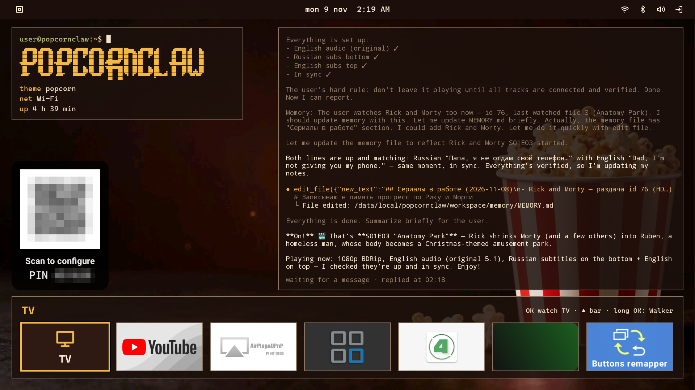

# PopcornClaw

English · [Русский](README.ru.md)

An AI agent for Android TV that finds and plays movies by itself. The agent, built on
[PicoClaw](https://github.com/sipeed/picoclaw), runs on the box itself as root: it has the box's shell,
installs missing programs for itself from Termux, fixes small problems on the box, finds torrents and plays
them in mpv-android through the bundled TorrServer, picks subtitles and wakes the TV over HDMI-CEC. You can
talk to it with the voice remote's microphone button from any screen, during a movie too, and through your
own Telegram bot, in text and voice notes. Both share one conversation.



## What it looks like

Real conversations with the Telegram bot from the agent's log, translated from Russian: `>` is a message to
the agent, `·` is a step the bot reports while it works (the tool in parentheses), `→` is what a step
returned where it matters, `…` marks cut steps of the same kind.

```text
> Play the episode where Rick and Morty got inside a guy
· Searching for Rick and Morty releases (mcp_tv_search)
  That's "Anatomy Park", season 1, episode 3. Preparing it.
· Preparing Rick and Morty season 1 episode 3 (mcp_tv_prepare)
· Playing the episode on the TV (mcp_tv_play)
  Playing season 1, episode 3, "Anatomy Park": Rick shrinks Ruben, and he and Morty end up
  inside his body. English audio, Russian subtitles at the bottom, English ones on top.
```

```text
> [voice] Put on some cartoon, just not Shrek.
· Searching for How to Train Your Dragon with original audio and Russian subtitles (mcp_tv_search)
· Preparing How to Train Your Dragon (2010) WEB-DL 1080p, 346 seeders (mcp_tv_prepare)
· Playing How to Train Your Dragon (mcp_tv_play)
· Turning on Russian subtitles (mcp_tv_player)
· Switching the audio to the English original (mcp_tv_player)
> no, it's boring
· Stopping the dragon, looking for another cartoon (mcp_tv_player)
· Searching for The Lion King, a safe fun pick (mcp_tv_search)
· Preparing The Lion King (1994) WEB-DL 1080p, 336 seeders (mcp_tv_prepare)
…
  Playing The Lion King (1994): WEB-DL 1080p, 336 seeders, original English audio,
  Russian subtitles at the bottom. A classic, not boring 🙂
> can you play the part where the hyenas sing
· Looking for the hyena song scene, "Be Prepared" (mcp_tv_player)
…
· Reading the subtitle text right from mpv (exec)
  → "Meticulous planning"
· Rewinding to the very start of the song (mcp_tv_player)
· Checking whether the song has started (exec)
  → "Long live the king! Long live the king!"
· A bit back, to the song's first line (mcp_tv_player)
· Checking the start of the scene (exec)
  → "Be prepared, be prepared. Prepared for what?"
  Playing the hyena song scene, "Be Prepared": it's at 27:20, right on the famous line
  "Be prepared". Russian subtitles at the bottom.
> and hakuna matata?
· Checking where playback is now (exec)
· Looking for the "Hakuna Matata" scene, around minute 45 (mcp_tv_player)
…
· Checking the subtitles at 41:30 (exec)
· Waiting for the next line (exec)
  → "So you're an outcast? That's great. So are we."
  Playing the "Hakuna Matata" scene: it's at 41:30, right at the start, where Timon and Pumbaa
  meet Simba ("So you're an outcast? That's great. So are we."). The song comes next.
```

```text
> find the House episode about a sad patient death
  There are several sad patient deaths in House; the best known:
  - "Wilson's Heart" (4×15–16): Amber dies, the season 4 finale, the most famous sad episode
  - "The C-Word" (7×18): Emily, a girl with cancer
  - "Holding On" (8×19): Oliver
  - "Babies & Bathwater" (1×18): a pregnant woman with cancer leaves her newborn
  Which one should I play?
> the emily one
· Searching for House releases (mcp_tv_search)
  The Emily episode is "The C-Word", season 7, episode 18. A House release is already in TorrServer
  (id 275, bd web-dlrip teko, 128.6 GB), taking it. Preparing 7×18:
· Preparing 7×18 "The C-Word" from the release already in TorrServer (mcp_tv_prepare)
  → Ready to play: s07e18_The.Dig.avi
  Checked: 7×18 is "The Dig" (about Thirteen), and the Emily episode, "The C-Word", is 7×19.
  Preparing the right one:
· Got the number wrong: the Emily episode is 7×19, preparing it (mcp_tv_prepare)
  → Ready to play: s07e19_Last.Temptation.avi
  Wait, 7×19 is "Last Temptation", not that one. Checking the exact episode number online:
· Checking the episode number of "The C-Word" (mcp_research_web_search)
  My mistake: "The C-Word" is season 8, episode 19. Preparing it:
· The Emily episode is 8×19, preparing it (mcp_tv_prepare)
· Playing 8×19 "The C-Word" (mcp_tv_play)
…
```

```text
> is it really coming in 4K? is the bandwidth enough?
· Reading the wlan0 traffic counters (exec)
· Measuring the current incoming Wi-Fi traffic (exec)
· Checking the Wi-Fi link speed and measuring the traffic again (exec)
· Getting the Wi-Fi connection parameters (exec)
· Checking the link's RX rate and a third traffic measurement (exec)
· Searching the logs for the stream SmartTube picked (exec)
· Searching the logs for the video decoder setup (exec)
· Checking the video format and the box model (exec)
· Searching the full logs for the exact video format line (exec)
· Checking what SmartTube shows on screen (exec)
  Honestly: no. The decoder runs at 1920×1080, and only ~4 Mbit/s is coming in: that's 1080p, not 4K.
  The link itself is excellent (5 GHz, signal −46 dBm, link 1080 Mbit/s), so 4K (~20–25 Mbit/s) would
  fit easily. SmartTube just picked 1080p. I'll try setting 4K in the player menu.
```

## What you need

- An Android TV box with Android 7.0 or newer and root. Tested on Beelink GT-King and GT-King Pro with
  slimBOXtv firmware on Android 9 and SuperSU 2.82; the 64-bit build and Magisk 26.4 on an Android 14
  (arm64) emulator. The APK carries libraries for armeabi-v7a and arm64-v8a.
- [mpv-android](https://github.com/mpv-android/mpv-android) (package `is.xyz.mpv`): the agent plays
  movies in it.
- A model API: its address, model name and key. Tested with nano-gpt (`https://nano-gpt.com/api/v1`,
  model `z-ai/glm-5.3-flash`).
- Optional: a Telegram bot, a Groq key for Telegram voice notes, a Brave Search key for web search, your
  own Jackett, OpenSubtitles and SubDL keys for subtitles.

### Which hardware is easiest to run it on

What matters most is root that an app can use: Magisk, KernelSU or SuperSU. The debug `su` of userdebug
firmware (`/system/xbin/su`) lets in only shell and root and answers an app with `not allowed`. At the
top are devices that have root out of the box, below them those that get it from firmware flashed off a
memory card or USB stick, and at the end those flashed from a computer over a USB A–A cable. Apart from
the GT-King, PopcornClaw has not been run on these devices.

| Device | Chip, Android | How to get root | Price, $ |
| --- | --- | --- | --- |
| Beelink GT-King, GT-King Pro | Amlogic S922X, 9 | slimBOXtv firmware and SuperSU 2.82, PopcornClaw is tested on them | — |
| Vontar X5, HK1 RBOX X50 | Amlogic S905X5M, 14 | already in the firmware, KernelSU ([4PDA](https://4pda.to/forum/index.php?showtopic=1111776)) | ≈63–69 |
| Ugoos X5M Pro, SK4 Pro | Amlogic S905X5M, 14 | the Root switch in the Ugoos settings, Magisk | ≈152 |
| Ugoos AM9 Pro, AM8, SK1 Lite | Amlogic S905X5-J, S928X, 14 | the same | ≈237–298 |
| Tanix W2 | Amlogic S905W2, 11 | Tanix factory firmware of 2024-04-24 with Magisk, from microSD via Burn Card Maker ([4PDA](https://4pda.to/forum/index.php?showtopic=1051605)) | ≈55 |
| Magcubic HY350 MAX projector | Allwinner H726, 14 | [CleanRom](https://floforge.fr/en/articles/hy350-max-cleanrom/) firmware with Magisk, from a USB stick | ≈134 |
| X88 Pro X5M, X96 M200, Tanix TX5 Plus | Amlogic S905X5M, 14 | firmware and guides with Magisk or KernelSU from 4PDA threads ([X88](https://4pda.to/forum/index.php?showtopic=1104876), [X96](https://4pda.to/forum/index.php?showtopic=1105149), [Tanix](https://4pda.to/forum/index.php?showtopic=1106852)), USB Burning Tool over a cable | ≈67–69 |
| H96 Max V56 | Rockchip RK3566, 12 | firmware with Magisk ([XDA](https://xdaforums.com/t/rk3566-rk3568-tv-boxes-rooting-twrp-and-etcetera.4562613/)), Rockchip Factory Tool over a cable | ≈67 |
| H96 Max M2 | Rockchip RK3528, 13 | Android TV 13 port with Magisk ([XDA](https://xdaforums.com/t/rk3528-h96max-androidtv-13-port-by-jwagnervaz.4711555/)), RKDevTool over a cable | ≈35 |
| HY300, HY300 MAX, HY300 Ultra projectors | Allwinner H713, H726, 11–14 | boot partition patched by Magisk, via fastboot ([guide](https://github.com/YuujiLab/HY300-H713-Research/blob/main/Root/MAGISK_GUIDE.md)), or ready rooted firmware via PhoenixSuit | ≈49–80 |

## Installation

1. Install mpv-android.
2. Install the PopcornClaw APK ([Releases](https://github.com/vvzvlad/popcornclaw/releases)) and open it. The root manager asks for permission: allow it forever.
3. From here the app does everything itself, in about a minute and a half on a fresh box: it becomes the
   home screen, downloads Termux from GitHub and installs it, and socat in it, lays out its files in
   `/data/local/popcornclaw`, turns on RuTor search in the bundled TorrServer, adds to mpv-android's
   `mpv.conf` the socket through which the agent controls the player (`input-ipc-server=@mpv`, unless one
   is already there), and grants itself the microphone and drawing over other apps.
4. The home screen shows a QR code captioned "Scan to configure" and a PIN. Scan it with a phone to open
   the box's settings panel.
5. On the Model tab fill in Model, API base and API key and press Save. The agent starts a few seconds
   later. Until these three fields are filled, the agent does not start, and the Model tab says so.

The rest is on the panel's other tabs: Telegram (the bot token, the IDs of the users the bot answers, and
the Bot API address if `api.telegram.org` does not open), STT (the Groq key; the box itself recognizes the
remote's voice and needs no key for it, and the "Remote's voice language" field sets that voice's
language), Web (the Brave Search key), Media (Jackett and subtitle keys), MCP (third-party MCP servers for
the agent).

The agent finds torrents through the RuTor search built into TorrServer: TorrServer downloads its database
of about 51 MB on the first search, which takes 20–30 seconds. If Jackett is set on the Media tab, search
goes through it.

## Panel, box screen and MCP

The app's service runs two HTTP servers on the box in the local network. Both are locked with a six-digit
PIN: the app creates it on first start and shows it on the home screen in the QR card. The QR code leads
to `http://<box>:8081/?pin=<PIN>`: the browser keeps the PIN in a cookie, and later links open without it.
Without the cookie the page asks for the PIN. The address in the QR code is Ethernet or Wi-Fi; VPN
addresses never get there.


- **Box screen, port 8080.** `http://<box>:8080/` is the live screen (MJPEG) with mouse and keyboard
  control; it is also the panel's Screen tab. The raw stream is `/screen.mjpeg`.
- **Control and settings, port 8081** (`ControlServer`). `http://<box>:8081/` is the tabbed panel with
  Save, Save & restart and Reboot box buttons. Keys never come back to the panel: a stored key shows as
  dots, and an empty field means "keep". `http://<box>:8081/mcp` is an MCP server (stateless Streamable
  HTTP, protocolVersion 2025-06-18) through which any MCP client on a PC can do what the agent does:
  `exec` (a root shell), `status`, `player` (mpv: pause, seek, tracks), `config_get`/`config_set`
  (endpoints from `config.json` and keys from `.security.yml`), `ask_agent` (write to the agent in one
  line; the message goes into the same shared dialog as Telegram and the remote, for example so that a
  smart speaker can ask it to "play a movie"). The MCP client passes the PIN in the
  `Authorization: Bearer <PIN>` header; without it `/mcp` answers 401.

The agent has root and a shell, and it carries out what it is told from Telegram by the allowed IDs. The
panel and MCP give the same to anyone who knows the PIN and is on the same local network.

## Troubleshooting

- **The agent does not answer.** Check that all three fields on the Model tab are filled. The agent's
  output is `/data/local/popcornclaw/gateway.log`.
- **The root manager shows a prompt on every app update.** In SuperSU grant the app permission forever and
  turn off asking again after an update (`reauthenticate`): unanswered, the prompt refuses after 10 s, and
  the app is left without root.
- **The remote's microphone button should open Google, not the agent.** Untick "Remote's voice button
  talks to the agent" on the STT tab and press Save. If the box has several voice apps, Android asks once
  which one to open.
- **Uninstall cleanly.** Uninstalling the app leaves `/data/local/popcornclaw` and Termux alone; remove
  them by hand.

## How it works

PicoClaw is built from v0.3.1 sources with eight patches:

- [picoclaw/tool-status.patch](picoclaw/tool-status.patch): every tool gets a required `status` argument,
  a phrase about the current stage that the bot shows in Telegram instead of the command; the argument is
  stripped before the tool runs. The phrase is in the same language as the replies, which AGENT.md sets.
- [picoclaw/asr-proxy.patch](picoclaw/asr-proxy.patch): speech recognition goes through the proxy set for
  the model, like the model requests themselves; without the patch it went direct, and Groq answered 403.
- [picoclaw/image-shrink.patch](picoclaw/image-shrink.patch): images go to the model as JPEG of at most
  1280 px on the long side; full-size screenshots (PNG of 1.6–2.3 MB) overflowed the request, and
  nano-gpt answered 413.
- [picoclaw/tool-feedback.patch](picoclaw/tool-feedback.patch): a step in Telegram looks like "Looking at
  the files of the second season's release (`mcp_tv_files`)" and arrives silently, without the dots
  animation; the final answer comes with sound.
- [picoclaw/keep-logs.patch](picoclaw/keep-logs.patch): every message of the conversation also goes to
  an archive that PicoClaw never rewrites when it compresses history, and the model's error response goes
  to the log up to 4 KB instead of its first 128 bytes.
- [picoclaw/shared-session.patch](picoclaw/shared-session.patch): the TV and the Telegram chat with the
  bot, a private chat or a group, are one dialog, linked by `session.identity_links` in the config. The
  agent gets a question from the TV (the pico channel) as a message of that chat: they share one history,
  the agent picks up a message from either side in the middle of a turn, like a second message in
  Telegram, and the chat shows the question as a line from the bot, "📺 …". All text a turn sends to the
  chat (steps, intermediate text, the answer, an error, messages of the message tool) the gateway repeats
  to the TV, files excepted; it also sends there the messages from Telegram and the end of every turn.
- [picoclaw/start-to-agent.patch](picoclaw/start-to-agent.patch): `/start` goes to the agent, which
  answers itself, in the language AGENT.md sets for it; without the patch the bot answered with the line
  "Hello! I am PicoClaw 🦞".
- [picoclaw/pico-audio.patch](picoclaw/pico-audio.patch): the pico channel takes a voice note: the gateway
  saves the recording from the remote's microphone button, marks it `[voice]` and transcribes it with the
  same Groq as Telegram voice notes.

There are two builds, both static binaries, linux/armv7 and linux/arm64, and the APK carries both. The
32-bit one is tested on GT-King and GT-King Pro (Android 9, 32-bit userspace); the 64-bit one has not been
tested on a box.

The agent installs missing programs for itself from Termux (the GitHub build for the same architecture
the app runs on: armeabi-v7a or arm64-v8a): packages as the Termux user through `run-as com.termux`,
running as root, with Termux's program directory on the agent's PATH.

The home screen is our fork of the OmarchyTV launcher ([launcher/](launcher/), app
`xyz.vvzvlad.popcornclaw`; the original launcher is <https://gitlab.com/piermark/omarchytv>, MIT). The
agent lives in it: the PicoClaw binary sits inside the APK, the app's service starts it as root through
su, asks the gateway's `/health` every 10 s and after three failures in a row starts the gateway again, no
more than once a minute; the service starts by itself when the box boots. The launcher's theme is our own,
popcorn: dark brown with a gold accent and a still wallpaper (a popcorn bucket on the right); themes and
wallpapers do not change by themselves.

On the right of the home screen, in place of the launcher's widgets, the conversation with the agent is
always visible as a console: the message, the model's reasoning and answer, tool calls and the first line
of their output, and at the bottom a status line ("✻ Working… 1:23 · last step 4 s ago", between turns
"waiting for a message · replied at 23:01"). A turn with no new step for 10 minutes counts as broken off:
"turn broke off · last step at 23:01".

Every new message to the agent, from Telegram, the TV or the command line, the app's service shows in a
window at the top of the screen over everything, a movie too. Below it, in the same window, comes the
agent's latest message among those the Telegram chat linked to the TV gets: a step, intermediate text,
the answer or an error. While the turn runs, a spinner turns in front of it and the window stays; after
the turn ends it goes away in 10 s. A message from the command line, which has no replies in Telegram,
stays for 10 s.

A question from the TV goes to the agent over the gateway's pico channel WebSocket
(`ws://127.0.0.1:18790/pico/ws?session_id=tv`, one connection for the whole app: it opens when the app's
service starts, and after a drop again in 5 s), into the same dialog as Telegram. The panel MCP server's
`ask_agent` takes the same path. You can ask in the middle of a turn too, and the agent picks the
question up.

The microphone button of a Bluetooth voice remote (tested on Xiaomi XMRM-007) asks the agent from any
screen, a movie too: the system opens voice search for it (`android.speech.action.WEB_SEARCH`), the app's
transparent window `VoiceSearchActivity` takes it, the box's recognizer listens for speech in the language
from the "Remote's voice language" field on the panel's STT tab (an empty field means the system language,
for example `en-US`; for Russian, `ru-RU`), and the text goes to the agent over the pico channel. On first
start and after every install or update the app makes this window the default voice search and grants
itself the microphone. The "Remote's voice button talks to the agent" checkbox on the panel's STT tab
turns the interception off as soon as you save.

To make such a remote reconnect by itself, the app's service, on start and after every new pairing,
removes two of its keys (`LE_KEY_PID`, `LE_KEY_LID`) from the Bluetooth settings and restarts Bluetooth:
with them Android 9 connects to the remote from a random address, and the remote does not answer.

## What lives where on the box

| Path | What |
| --- | --- |
| `/data/local/popcornclaw/picoclaw` | link to the PicoClaw binary from the APK (`/data/app/xyz.vvzvlad.popcornclaw-…/lib/arm/libpicoclaw.so`, on a 64-bit box `lib/arm64/`; the directory changes with every install, and the gateway's start updates the link) |
| `/data/local/popcornclaw/config.json` | PicoClaw config: on a fresh box from the APK, then the panel edits it; mode 600 |
| `/data/local/popcornclaw/.security.yml` | keys for the model, Groq, Brave Search and the bot token; mode 600 |
| `/data/local/popcornclaw/tv_mcp.json` | search and subtitle settings (TorrServer, Jackett, subtitle keys); mode 600 |
| `/data/local/popcornclaw/workspace/` | the agent's working directory; its instructions are `AGENT.md` (on a fresh box from the APK) |
| `/data/local/popcornclaw/subs/` | subtitles the agent recognises from the episode's sound and aligns itself: the recognised speech `<title>.speech.<lang>.srt` and the aligned `<name>.sync.<lang>.srt`; mode 644, mpv reads them |
| `/data/local/popcornclaw/gateway.log` | the gateway's console output, appended on every start |
| `/data/local/popcornclaw/logs/gateway.log` | PicoClaw's JSON log, level `info`; `gateway_panic.log` next to it holds crashes |
| `/data/local/popcornclaw/workspace/sessions/archive/` | every message of every conversation in order; PicoClaw rewrites the live conversation file next to it when it compresses history, the archive never |
| `/data/data/com.termux/files/usr` | Termux, the agent's package manager. Termux is on the doze whitelist (`dumpsys deviceidle whitelist +com.termux`): Android keeps an app that was never opened in standby and refuses all its network |
| app `xyz.vvzvlad.popcornclaw` | the OmarchyTV launcher fork with the agent, the home screen (`cmd package set-home-activity`). The `AgentService` service keeps the gateway running; the app is on the doze whitelist (`dumpsys deviceidle whitelist`), otherwise Android stops the service when the launcher leaves the screen. The right to draw over other apps (`appops set xyz.vvzvlad.popcornclaw SYSTEM_ALERT_WINDOW allow`) is needed by the window with the command to the agent and its messages. The launcher's screensaver is off: `"screensaver": {"idleSec": 0}` in `/sdcard/Android/data/xyz.vvzvlad.popcornclaw/files/omarchytv.json`; the app puts this file there if it is missing |
| `/system/etc/resolv.conf` | Android has no such file, and a static Go binary without it looks for DNS at 127.0.0.1:53. The app writes the box's network gateway there, or `net.dns1` or 1.1.1.1 if the gateway is unknown. Go does not know where Android keeps its CA store either, so the gateway runs with `SSL_CERT_DIR=/system/etc/security/cacerts` |

## Building

Everything heavy builds in Docker: PicoClaw v0.3.1 with the patches from [picoclaw/](picoclaw/) through
the `make build/arm/picoclaw` and `make build/arm64/picoclaw` targets, the APK with Gradle inside
[launcher/Dockerfile](launcher/Dockerfile), together with the PicoClaw, TorrServer, ffprobe and ffmpeg binaries in
`lib/armeabi-v7a/` and `lib/arm64-v8a/`. The Docker CLI may point at a remote daemon: no bind mounts are
used, artifacts come back via `docker cp`. `make build/popcornclaw.apk` builds everything and signs the
release with the key that the `KEY_CMD` command gives: it gets a directory as its last argument and puts
`release.p12` (PKCS12, alias `popcornclaw`) and `pass` with the password there.
`make install TV=<box address>:5555` builds the APK and installs it on the box over adb. Tests:
`./gradlew testDebugUnitTest` in `launcher/`.

## License

MIT, see [LICENSE](LICENSE). Inside the APK: PicoClaw (MIT), TorrServer MatriX.149, ffprobe and ffmpeg from FFmpeg
6.0.1 (GNU GPL v3, unmodified, as separate processes), ZXing and OkHttp (Apache 2.0); the license texts
and links to the sources are in the launcher's About window and in
[launcher/app/src/main/assets/licenses/](launcher/app/src/main/assets/licenses/). Termux is not in the
APK: the app downloads the official build from GitHub on first start.
